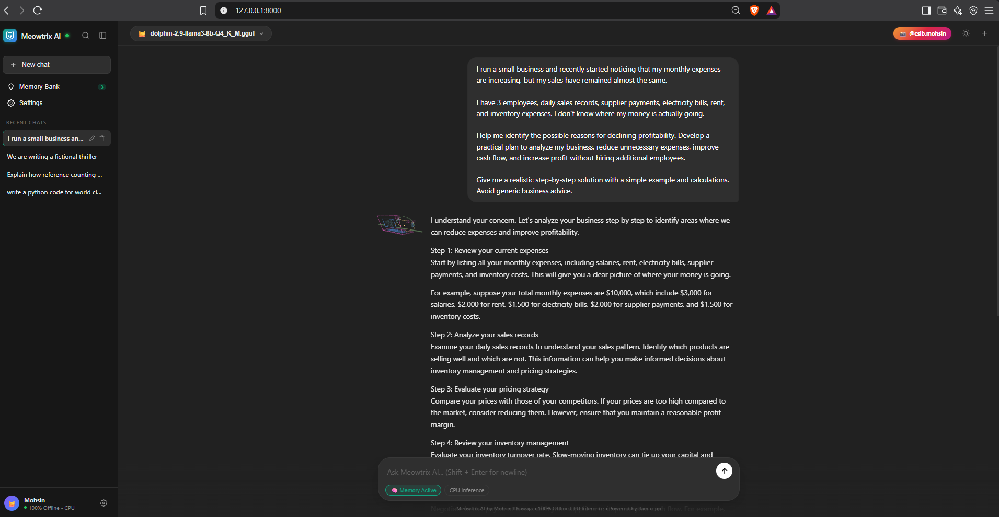

# 🐱 Meowtrix AI — 100% Offline Multi-GGUF Local AI Studio

<p align="center">
  
  
  
  
  
  
</p>

<p align="center">
  <b><i>"Zero-Setup, 100% Private Local LLM Chat Studio with Dynamic GGUF Hot-Swapping"</i></b><br>
  Engineered by <b>Mohsin Khawaja</b> &bull; Follow on Instagram: <a href="https://www.instagram.com/csib.mohsin/"><b>@csib.mohsin</b></a>
</p>

---

<p align="center">
  
  <br><i>Meowtrix AI: 100% Offline Multi-GGUF Local LLM Studio with dynamic hot-swapping and memory bank</i>
</p>

---

## ⚡ Why Meowtrix AI?

Most local LLM tools require heavy background daemons, complex Docker setups, or command-line wrappers like Ollama.  
**Meowtrix AI** eliminates all friction:

* ✅ **Zero Ollama & Zero Docker Needed**: Runs 100% purely in Python via CPU-optimized `llama-cpp-python`.
* ✅ **Multi-GGUF Hot-Swapping**: Drop any `.gguf` models into the `models/` directory and switch between them on-the-fly directly from the top navigation bar—without restarting the server!
* ✅ **100% Private & Air-Gapped**: Zero telemetry, zero external API keys, zero cloud dependencies. Your conversations and data never leave your computer.
* ✅ **Hardware-Optimized CPU Inference**: Multi-threaded CPU execution with intelligent core allocation, streaming token output, and real-time generation abort controls.
* ✅ **Persistent Long-Term Memory Bank**: Store user facts, coding styles, and project context that automatically augment multi-turn prompts.
* ✅ **Sleek Web Interface**: ChatGPT-style fluid experience with markdown rendering, syntax-highlighted code blocks with 1-click copy buttons, chat search, conversation renaming, and Dark/Light themes.

```
                              MEOWTRIX AI ARCHITECTURE
                              
  +------------------------------------------------------------------------+
  |                        MODELS DIRECTORY (/models)                      |
  |  [llama-3.2-3b.gguf]   [qwen-2.5-7b.gguf]   [phi-3.5.gguf]   ...       |
  +------------------------------------------------------------------------+
                                      |
                                      v  Dynamic Hot-Swapping
  +------------------------------------------------------------------------+
  |                   MEOWTRIX INFERENCE CORE (main.py)                    |
  |  - llama-cpp-python CPU Engine (AVX2 / Multi-Threading)                |
  |  - Active Model Manager & Garbage Collector Memory Reclaimer           |
  |  - Real-Time Streaming Server-Sent Generation & Thread Abort Events    |
  |  - SQLite Persistent Multi-Turn History & Long-Term Memory Bank        |
  +------------------------------------------------------------------------+
                                      |
                                      v  FastAPI Web Server (Port 8000)
  +------------------------------------------------------------------------+
  |                     MODERN SAAS WEB DASHBOARD                          |
  |  - Header Model Selector Pill with Real-Time Hot-Swapping              |
  |  - Streaming Markdown & Code Syntax Highlighting                       |
  |  - Memory Bank Modal, Settings Drawer & Instant Port Conflict Resolver |
  +------------------------------------------------------------------------+
```

---

## 🚀 Recommended GGUF Models

Meowtrix AI supports any standard GGUF model from HuggingFace. Below are top-performing models that run smoothly on regular CPUs:

| Model | Parameters | Quantization | RAM / Size | Best For | HuggingFace Link |
| :--- | :---: | :---: | :---: | :--- | :--- |
| **Llama 3.2 1B Instruct** | 1B | `Q4_K_M` | ~800 MB | Ultra-fast on low-spec laptops | [Download GGUF](https://huggingface.co/bartowski/Llama-3.2-1B-Instruct-GGUF) |
| **Llama 3.2 3B Instruct** | 3B | `Q4_K_M` | ~2.0 GB | Everyday chats & smart reasoning | [Download GGUF](https://huggingface.co/bartowski/Llama-3.2-3B-Instruct-GGUF) |
| **Phi-3.5 Mini Instruct** | 3.8B | `Q4_K_M` | ~2.3 GB | High reasoning, logic, and coding | [Download GGUF](https://huggingface.co/bartowski/Phi-3.5-mini-instruct-GGUF) |
| **Qwen 2.5 3B / 7B Instruct** | 3B / 7B | `Q4_K_M` | ~2.2G / ~4.6G | Complex programming & STEM | [Download GGUF](https://huggingface.co/Qwen/Qwen2.5-7B-Instruct-GGUF) |
| **Mistral 7B Instruct v0.3** | 7B | `Q4_K_M` | ~4.4 GB | Creative writing & conversation | [Download GGUF](https://huggingface.co/bartowski/Mistral-7B-Instruct-v0.3-GGUF) |
| **Dolphin 2.9 Llama 3 8B** | 8B | `Q4_K_M` | ~4.9 GB | Deep reasoning & uncensored tasks | [Download GGUF](https://huggingface.co/cognitivecomputations/dolphin-2.9-llama3-8b-gguf) |
| **DeepSeek R1 Distill Qwen 1.5B** | 1.5B | `Q4_K_M` | ~1.1 GB | Lightweight chain-of-thought logic | [Download GGUF](https://huggingface.co/bartowski/DeepSeek-R1-Distill-Qwen-1.5B-GGUF) |

---

## ⚡ Quick Start

### Option A: One-Click Launcher (Windows)
Double-click **`run.bat`**.  
The launcher will automatically verify Python, auto-install missing dependencies, initialize `models/` and `data/` directories, launch the local server, and open your browser at `http://127.0.0.1:8000`.

### Option B: Linux / macOS
```bash
chmod +x run.sh
./run.sh
```

### Option C: Manual Setup
```bash
# 1. Clone the repository
git clone https://github.com/csibmohsin/meowtrix-ai.git
cd meowtrix-ai

# 2. Install dependencies (CPU-optimized prebuilt wheels included)
pip install -r requirements.txt

# 3. Add your favorite .gguf file to the models/ folder
# (e.g. models/llama-3.2-3b-instruct-q4_k_m.gguf)

# 4. Start the server
python main.py
```
Open **`http://127.0.0.1:8000`** in your browser.

---

## 📁 Adding & Switching Models

1. Place any `.gguf` file inside the **`models/`** folder.
2. In the Meowtrix AI web dashboard, click the **Model Selector** dropdown at the top left.
3. Select your model—Meowtrix AI will hot-swap the model in memory immediately without server restarts!

---

## 📂 Repository Topology

```text
meowtrix-ai/
│
├── models/                       # Drop your .gguf models here (.gitkeep)
│   └── README.md                 # Model download guide & direct links
│
├── data/                         # Local SQLite persistent storage (.gitkeep)
│
├── index.html                    # Single-page modern chat interface
├── main.py                       # FastAPI server, multi-model manager & CPU inference
├── requirements.txt              # Pure Python dependencies with CPU wheels
├── run.bat                       # One-click Windows runner & auto-installer
├── run.sh                        # One-click Unix/macOS launcher
├── .gitignore                    # Automatically excludes large GGUF models & DBs
└── LICENSE                       # Personal & Non-Commercial License
```

---

## 👤 Author & Credits

- **Developer**: **Mohsin Khawaja**
- **Instagram**: [@csib.mohsin](https://www.instagram.com/csib.mohsin/)
- **GitHub**: [@csibmohsin](https://github.com/csibmohsin)

---

## 📄 License & Terms of Use

This software is governed by the **Personal & Non-Commercial License** ([LICENSE](LICENSE)) &bull; Copyright &copy; 2026 **Mohsin Khawaja**.

- ✅ **Authorized**: Personal experimentation, educational study, private use, and non-commercial research.
- ❌ **Prohibited**: Commercial redistribution, software-as-a-service (SaaS) hosting for profit, reselling, or bundling into commercial packages without express written authorization.

